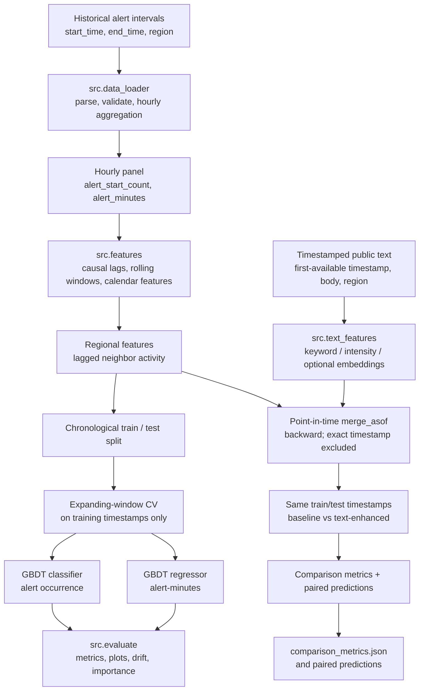

# Ukraine Air Raid Alerts — Time Series Forecasting Pipeline

A modular Python research project for forecasting hourly air-raid alert activity across Ukrainian regions. The repository combines historical alert intervals, causal time-series features, regional co-occurrence signals, and optional timestamped public-text indicators in a reproducible machine-learning workflow.

> **Research prototype — not an official alerting system.** This project has not been validated for operational warning, emergency decision-making, or life-safety use. Forecasts are uncertain and must not replace official alerts or guidance from Ukrainian authorities.

## Table of contents

- [Executive summary and defense context](#executive-summary-and-defense-context)
- [Architecture](#architecture)
- [Anti-data-leakage strategy](#anti-data-leakage-strategy)
- [Data contract](#data-contract)
- [Time-series and multimodal features](#time-series-and-multimodal-features)
- [Models and evaluation](#models-and-evaluation)
- [Model performance and findings](#model-performance-and-findings)
- [Reproduction guide](#reproduction-guide)
- [Tests and quality checks](#tests-and-quality-checks)
- [Known limitations and next steps](#known-limitations-and-next-steps)
- [Repository layout](#repository-layout)

## Executive summary and defense context

Air-raid alert records form a regional, event-driven time series with long quiet periods, temporal clustering, regional dependence, and occasional high-impact spikes. The aim of this project is to build a transparent baseline pipeline that turns historical alert intervals into hourly observations and estimates two related outcomes for each region-hour:

1. **Alert occurrence:** the probability that alert activity is present at some point in the target hour.
2. **Alert duration intensity:** the predicted sum of alert-minutes within the target hour.

Hourly alert-start counts are also retained as an outcome and as historical information for lag features. The current baseline models occurrence and alert-minutes; it does **not** claim to predict every aspect of an alert event or its operational consequences.

Potential research uses include studying temporal patterns, measuring regional co-occurrence, assessing whether timestamped public reports add predictive signal beyond alert history, and stress-testing forecasting methodology under changing conditions. These are retrospective forecasting experiments, not a substitute for official warnings.

### Project objectives

- Establish a repeatable ingest → aggregate → feature → split → train → evaluate workflow.
- Enforce chronological evaluation rather than random row-level splits.
- Exclude same-hour outcomes from their own predictors.
- Align public-text signals by when a report became available, not by a retrospectively inferred event time.
- Compare a time-series-only model with a time-series-plus-text model on the same out-of-time rows.
- Produce machine-readable metrics, prediction tables, diagnostic plots, and permutation-importance reports.

## Architecture

The project exposes separate module CLIs so each stage can be inspected, tested, and rerun independently.



### Core modules

| Module | Responsibility | Main outputs |
|---|---|---|
| `src/data_loader.py` | Load and validate historical alert records; calculate interval overlaps in UTC hourly buckets. | `hourly.csv`, initial `supervised.csv`, split CSVs when using its standalone CLI. |
| `src/features.py` | Build the canonical causal feature set, check region-hour continuity, and split chronologically. | `supervised.csv`, `train.csv`, `test.csv`. |
| `src/model.py` | Tune and fit GBDT classifier/regressor pipelines using expanding-window CV, then evaluate once on an out-of-time test set. | Model `.joblib` files, `test_predictions.csv`, `test_metrics.json`. |
| `src/text_features.py` | Extract timestamped text signals, join them point-in-time, and compare time-series-only against time-series-plus-text models. | Paired predictions, `comparison_metrics.json`, model artifacts. |
| `src/evaluate.py` | Evaluate saved models and produce time-series charts, permutation importance, and drift diagnostics. | PNG charts, CSV diagnostics, JSON metrics. |

## Anti-data-leakage strategy

Leakage control is a first-class design requirement. The project applies several complementary controls, but **passing these code checks alone does not prove that every external source record was available to a real forecasting system at the historical forecast time**. That stronger claim requires trustworthy source-availability timestamps; see [Known limitations and next steps](#known-limitations-and-next-steps).

### 1. Target interval and historical features

A row with `bucket_start = t` describes the target hour `[t, t + 1 hour)`. The intended operating mode is a rolling one-step-ahead forecast issued at the boundary `t`, using only completed history before `t`.

Lag features use earlier buckets, and rolling calculations shift the grouped series before calculating the window. Conceptually:

```python
# `group` is one region's time-ordered target series.
lag_1h = group.shift(1)
rolling_24h_mean = group.shift(1).rolling(
    window=24,
    min_periods=24,
).mean()
```

The `shift(1)` is essential: without it, the rolling statistic could include the target hour's own label. The feature builder also checks for duplicate or missing hourly timestamps rather than silently interpreting a multi-hour gap as a one-hour lag.

### 2. Strict chronological holdout

The split uses unique timestamps, not random panel rows. All regions with the same `bucket_start` are assigned to the same side of the boundary. Training timestamps must end strictly before test timestamps begin. The default is to hold out the most recent 20% of timestamps; use `--split-time` when a fixed test start is preferred.

Hyperparameter tuning uses expanding-window `TimeSeriesSplit` folds over unique timestamps from the **training partition only**. The held-out test period is not used to select model parameters. For this one-step-ahead task, earlier observed test hours can become historical inputs to later test-hour forecasts. That is appropriate only for a rolling deployment where observations are received as time advances; it is not a fixed-origin multi-hour forecast.

### 3. Preprocessing fitted inside each fold

The baseline uses scikit-learn `Pipeline` and `ColumnTransformer`. The region `OneHotEncoder` is fitted as part of each fold's estimator. Tree-based HistGradientBoosting models do not require feature scaling, so numeric features are passed through rather than globally standardized. No data-dependent imputation is fitted over the combined train/test data.

If scalers, imputers, text vectorizers, target encoders, or learned dimensionality reductions are added later, they must be placed inside the pipeline and fitted on each training fold only. A frozen external text encoder is a different case, but its version and availability should still be documented.

### 4. Point-in-time text alignment

For a forecast reference time `t`, the text pipeline intends each feature window to cover `[t - window, t)`. The join uses `pandas.merge_asof` with backward matching and `allow_exact_matches=False`; a report timestamped exactly at `t` is excluded.

```python
pd.merge_asof(
    left.sort_values("forecast_reference_timestamp"),
    right.sort_values("text_timestamp"),
    left_on="forecast_reference_timestamp",
    right_on="text_timestamp",
    direction="backward",
    allow_exact_matches=False,
)
```

The `text_timestamp` field must mean the first time the report was available to the forecasting pipeline. Do not replace it with a backdated event time extracted from report text. Global reports can contribute to each region; region-specific reports should match only their intended region.

### 5. Target and metadata exclusion

The feature whitelist excludes same-hour targets and metadata such as `bucket_start`, `feature_cutoff`, `alert_start_count`, `alert_minutes`, and `alert_occurrence`. Runtime checks also validate target completeness, feature finiteness, and train/test chronology.

> **Important availability-time caveat:** `feature_cutoff` is currently bucket-label metadata representing the preceding hourly bucket, not a measured source-ingestion timestamp. It validates the intended temporal construction but cannot prove that an upstream record was not delayed, revised, or reconstructed retrospectively. For an auditable zero-leakage backtest, preserve each source record's `first_available_at` / ingestion timestamp and test it against the actual forecast issue time.

## Data contract

The repository does not include a complete production dataset. Place locally obtained data under `data/raw/` and verify its provenance, license, definitions, and coverage before running a benchmark.

### Historical alert events

The loader accepts CSV, Parquet, JSON, or JSONL. Its default input columns are:

| Column | Meaning | Requirements |
|---|---|---|
| `start_time` | Alert interval start | Required, parseable timestamp. |
| `end_time` | Alert interval end | Required, parseable timestamp; must not precede start. |
| `region` | Region identifier | Required; labels must be consistent across data and adjacency configuration. |
| `duration` | Optional source duration | Used for QA when present; the canonical duration is derived from `end_time - start_time`. |

Timestamps are normalized to UTC. Naive timestamps are interpreted as UTC by default; use `--naive-timezone` if the source defines naive timestamps in another timezone. Numeric durations default to seconds; set `--duration-unit` to match the source if needed.

Alert intervals are treated as half-open intervals `[start_time, end_time)`. `alert_start_count` counts intervals starting in a bucket. `alert_minutes` sums interval overlap with each region-hour and can exceed 60 when multiple alerts overlap. These are target labels; same-hour values are not valid predictors for the same row.

Use `--coverage-start` and `--coverage-end` to specify inclusive UTC bucket-start boundaries when the source's observation window is known. This creates zero-valued hours inside the bounded period for regions observed in the source. **It cannot infer a region that never appears in the event file**, and event-only data cannot distinguish a true quiet period from an archive outage without feed-coverage metadata.

### Timestamped public-text events (optional)

The default text CSV schema is:

| Column | Meaning | Requirements |
|---|---|---|
| `text_timestamp` | First-available / first-observed timestamp | Required. Must record when the report became available to the pipeline. |
| `text` | Report body or title | Required. Used for transparent keyword rules. |
| `region` | Regional scope | Optional. A missing or global label indicates a nationwide report; regional labels must match the hourly panel. |
| `embedding_0`, `embedding_1`, ... | Precomputed numeric embeddings | Optional; dimensions must be finite and consecutively numbered. |

Text indicators include report counts over trailing windows, keyword-group counts (including missile, drone, air-activity, attack, and official-alert terminology), a heuristic intensity feature, time since the latest prior report, optional coverage indicators, and optional rolling mean embeddings. Keyword scores are transparent heuristics, not calibrated probabilities or a trained threat classifier.

If an embedding encoder is trained or fine-tuned on project data, fit it on training-fold texts only. The module accepts precomputed embeddings; it does not download or train a language model.

## Time-series and multimodal features

### Time-series features

- **Historical lags:** alert starts and alert-minutes over the preceding 1, 3, 6, 24, and 168 hours.
- **Trailing summaries:** shifted rolling sums and means over defined hourly windows, including 3 hours, 6 hours, 24 hours, and 7 days where configured.
- **Calendar cycles:** hour-of-day and day-of-week encodings, with sine/cosine features plus local calendar indicators.
- **Regional co-occurrence:** prior alert activity in adjacent regions, represented through lagged and rolling signals.
- **Target labels:** `alert_occurrence` is derived from whether `alert_minutes > 0`; the regressor predicts non-negative alert-minutes for the target hour.

The default region adjacency map is a starting point, not an authoritative topology. Validate aliases and adjacency against the source schema. If required, pass a project-validated JSON mapping with `--neighbors-json`:

```json
{
  "Region A": ["Region B"],
  "Region B": ["Region A", "Region C"],
  "Region C": ["Region B"]
}
```

Every region in the input must be covered by the mapping; unknown labels should fail rather than silently create misleading zero-valued neighbor features.

### Multimodal comparison

`src.text_features` joins text signals to the complete supervised time-series frame before splitting. It then creates both feature sets using identical chronological train/test rows and expanding-window folds:

- `time_series_only`: lagged alert history, calendar, and regional features.
- `time_series_plus_text`: the same rows and base features, plus point-in-time text signals.

The comparison is designed to measure whether text improves the benchmark. It does not assume that adding text will help; the result depends on report coverage, source latency, language, keyword quality, and the event's temporal relationship to alert outcomes.

## Models and evaluation

### Baseline estimators

| Task | Estimator | Prediction |
|---|---|---|
| Occurrence | `HistGradientBoostingClassifier` | Alert-active probability for a target hour. |
| Duration | `HistGradientBoostingRegressor` | Predicted alert-minutes, clipped to non-negative values for reporting. |

Hyperparameters are selected by a small grid search on expanding-window training folds. One-hot encoding for region is fitted inside each fold's scikit-learn pipeline. There is no global fit of a scaler or imputer. If available training folds do not contain sufficient class diversity for ROC-AUC tuning, classifier tuning may fall back to the default GBDT configuration; inspect logs and metrics rather than assuming tuning occurred.

### Reported metrics

**Occurrence / classification**

- ROC-AUC, when the test set contains both classes.
- Average precision and Brier score in the saved-model evaluation report when defined by the current implementation.
- Precision and recall at a configurable threshold (default `0.5`). This threshold is a baseline convention, not a calibrated operational decision threshold.
- Actual alert rate and false-positive rate on zero-duration rows.

**Duration / regression**

- Mean absolute error (MAE), in alert-minutes.
- Root mean squared error (RMSE), in alert-minutes; larger misses are penalized more heavily.
- MAE on positive-duration rows and diagnostics for high-duration episodes, zero-target fraction, and underprediction.

ROC-AUC is undefined when the test labels contain only one class. Brier score, however, remains meaningful for a single-class test set; verify its presence in `evaluation_metrics.json` before interpreting results. Metrics should be reported with the test period, row count, class prevalence, and coverage context.

## Model performance and findings

No real-data benchmark numbers are hard-coded in this README because no complete, provenance-verified dataset or real-data test report was supplied with the repository. Do not present synthetic smoke-test results as evidence of forecasting quality. Run the pipeline and populate the table below from the generated `comparison_metrics.json` after evaluating a representative, chronologically held-out period.

| Metric | Time-series-only baseline | Time series + text | Preferred direction |
|---|---:|---:|---|
| Alert occurrence ROC-AUC | Not benchmarked yet | Not benchmarked yet | Higher |
| Precision at threshold 0.5 | Not benchmarked yet | Not benchmarked yet | Depends on false-alarm cost |
| Recall at threshold 0.5 | Not benchmarked yet | Not benchmarked yet | Higher when missed alerts are costly |
| Alert-minutes MAE | Not benchmarked yet | Not benchmarked yet | Lower |
| Alert-minutes RMSE | Not benchmarked yet | Not benchmarked yet | Lower |

The multimodal comparison writes `artifacts/text_comparison/comparison_metrics.json`. It records each model's out-of-time scores and `text_minus_baseline_delta`; for ROC-AUC, precision, and recall, positive deltas are favorable, while for MAE and RMSE, negative deltas are favorable. Precision and recall should be interpreted together, and the threshold should be selected according to documented goals using training-period validation—not tuned on the final test set.

### Visual diagnostics

`src.evaluate` produces:

- `actual_vs_predicted_alert_minutes.png` — actual and predicted alert-minutes over the test period.
- `actual_vs_predicted_occurrence.png` — observed occurrence versus predicted probability.
- `regional_actual_vs_predicted.png` — regional alert-minutes panels for selected high-volume regions.
- `permutation_importance_occurrence.png` and `permutation_importance_duration.png` — permutation-importance plots, with corresponding CSV tables.
- `weekly_diagnostics.csv` — performance summaries by week.
- `target_drift_summary.json` and `evaluation_metrics.json` — target-distribution and metric reports.

Use these visuals to inspect systematic underprediction of spikes, false alarms during quiet periods, regional heterogeneity, and changes in target prevalence. Permutation importance is computed on a bounded sample of the test set for **post-hoc interpretation only**; do not use it to select features and then treat the same test metrics as an unbiased final evaluation.

## Reproduction guide

### 1. Create an environment and install dependencies

Recommended: Python 3.10 or newer.

```bash
python -m venv .venv

# macOS / Linux
source .venv/bin/activate

# Windows PowerShell
# .venv\Scripts\Activate.ps1

python -m pip install --upgrade pip
pip install -r requirements.txt
```

The dependency file includes pandas, NumPy, scikit-learn, joblib, matplotlib, and optional `pyarrow` support for Parquet files.

### Quick smoke test with synthetic demo data

The uploaded three-row `test_alerts.csv` is not long enough for the default 168-hour lag/rolling windows and is not sufficient to train a meaningful model. To verify the full installation before using your real archive, generate a clearly labelled synthetic dataset:

```bash
python scripts/generate_demo_data.py --output-dir data/demo --hours 520
python -m src.pipeline data/demo/alerts.csv \
  --coverage-start "2025-01-01T00:00:00Z" \
  --coverage-end "2025-01-22T15:00:00Z" \
  --regions "Demo North" "Demo South" \
  --neighbors-json data/demo/neighbors.json \
  --text-events data/demo/text_events.csv \
  --source-coverage-start "2025-01-01T00:00:00Z" \
  --output-dir artifacts/demo \
  --n-splits 2 \
  --skip-plots
```

This exercises both the time-series-only and time-series-plus-text comparison. Remove `--skip-plots` to create charts and permutation-importance reports. **The generated data and its metrics are synthetic and must never be presented as real forecasting performance.**

### 2. Prepare the input files

Place your alert archive at `data/raw/alerts.csv`. Adjust column names in the source data to the documented schema or adapt the loader before running. Optional public reports should be saved as `data/raw/public_text.csv` with `text_timestamp`, `text`, and optionally `region` plus precomputed embedding columns.

The timestamp coverage values below are examples only. Replace them with the actual observed source window; do not invent a coverage period merely to fill silent hours.

### 3. Aggregate alert intervals into hourly rows

```bash
python -m src.data_loader data/raw/alerts.csv \
  --coverage-start "2024-01-01T00:00:00Z" \
  --coverage-end "2026-10-15T23:00:00Z" \
  --output-dir data/processed
```

Outputs include `hourly.csv`. The coverage boundaries are inclusive UTC hourly bucket-start timestamps. If coverage metadata is unknown, omit these flags and document that silent-period coverage is uncertain.

### 4. Build causal features and create the out-of-time split

```bash
python -m src.features data/processed/hourly.csv \
  --output-dir data/processed/model_data \
  --test-fraction 0.2
```

If source region names do not match the starter adjacency map, supply a validated mapping:

```bash
python -m src.features data/processed/hourly.csv \
  --output-dir data/processed/model_data \
  --test-fraction 0.2 \
  --neighbors-json config/region_neighbors.json
```

This creates `supervised.csv`, `train.csv`, and `test.csv`. The warm-up rows without enough historical windows are dropped by default. Keep the default behavior unless there is a documented reason to retain incomplete windows.

### 5. Train and evaluate the time-series-only baseline

```bash
python -m src.model \
  data/processed/model_data/train.csv \
  data/processed/model_data/test.csv \
  --output-dir artifacts/baseline \
  --n-splits 5
```

Main outputs:

- `artifacts/baseline/alert_occurrence_gbdt.joblib`
- `artifacts/baseline/alert_minutes_gbdt.joblib`
- `artifacts/baseline/test_predictions.csv`
- `artifacts/baseline/test_metrics.json`

### 6. Generate visual evaluation and drift reports

```bash
python -m src.evaluate \
  data/processed/model_data/train.csv \
  data/processed/model_data/test.csv \
  artifacts/baseline/alert_occurrence_gbdt.joblib \
  artifacts/baseline/alert_minutes_gbdt.joblib \
  --output-dir artifacts/evaluation
```

### 7. Optional: compare the time-series model with text-enhanced features

```bash
python -m src.text_features \
  data/processed/model_data/supervised.csv \
  data/raw/public_text.csv \
  --output-dir artifacts/text_comparison \
  --text-timestamp-col text_timestamp \
  --text-col text \
  --test-fraction 0.2 \
  --n-splits 5 \
  --source-coverage-start "2024-01-01T00:00:00Z"
```

Replace `--source-coverage-start` with the first date at which the text feed is known to be complete. Omit it if unknown and preserve that uncertainty in the benchmark notes. The command produces the enriched datasets, paired test predictions, comparison metrics, and fitted models for both variants.

To generate separate visual reports for the text-enhanced model, use its matching datasets and artifacts:

```bash
python -m src.evaluate \
  artifacts/text_comparison/train_with_text.csv \
  artifacts/text_comparison/test_with_text.csv \
  artifacts/text_comparison/time_series_plus_text_classifier.joblib \
  artifacts/text_comparison/time_series_plus_text_regressor.joblib \
  --output-dir artifacts/evaluation_text
```

### 8. Run the complete project with one command

The repository includes `src/pipeline.py`, which orchestrates loading, hourly aggregation, causal feature engineering, chronological splitting, model tuning, evaluation, and artifact saving. This is the recommended route for a fresh run.

```bash
python -m src.pipeline data/raw/alerts.csv \
  --coverage-start "2024-01-01T00:00:00Z" \
  --coverage-end "2026-10-15T23:00:00Z" \
  --regions "Kyiv Oblast" "Lviv" \
  --output-dir artifacts/run \
  --n-splits 5
```

The dates and region roster above are examples. Replace them with your verified source coverage and exact region labels. By default, the runner uses the starter Ukrainian-region adjacency map. If your source labels or geography differ, pass `--neighbors-json path/to/your_map.json`; the JSON must map every region in the hourly panel to a list of adjacent regions. For non-geographic synthetic region labels, `--no-neighbor-features` explicitly disables adjacency signals; do not use that option for a geography-aware benchmark.

To run the multimodal comparison, add a timestamped public-text CSV:

```bash
python -m src.pipeline data/raw/alerts.csv \
  --coverage-start "2024-01-01T00:00:00Z" \
  --coverage-end "2026-10-15T23:00:00Z" \
  --regions "Kyiv Oblast" "Lviv" \
  --text-events data/raw/public_text.csv \
  --text-timestamp-col text_timestamp \
  --text-col text \
  --text-region-col region \
  --source-coverage-start "2024-01-01T00:00:00Z" \
  --output-dir artifacts/run_multimodal \
  --n-splits 5
```

The `text_timestamp` field must reflect when the report first became available to the forecasting system, not just the time of the underlying event. The point-in-time join excludes a report whose timestamp equals the forecast reference.

The runner writes `data/hourly.csv`, `data/supervised.csv`, `data/train.csv`, `data/test.csv`, model artifacts, JSON metrics, predictions, and (unless `--skip-plots` is supplied) charts and permutation-importance reports below the selected output directory.

The public Python API `train_and_evaluate()` also accepts common mock-frame aliases (`timestamp`, `occurrence`, `duration`) and normalizes them to the project's canonical names (`bucket_start`, `alert_occurrence`, `alert_minutes`). In a preprocessed model frame, `duration` must already be in the target unit **minutes**; raw event-level duration in seconds belongs in the loader input, not in this model API. Files written by the pipeline always use canonical names. If no timestamp alias is present, the code raises a descriptive `ValueError` listing required columns instead of leaking a `KeyError` from `assert_temporal_integrity()`.

## Tests and quality checks

From the repository root, run the test suite:

```bash
python -m unittest discover -s tests -v
```

The suite covers point-in-time text alignment, timestamp-boundary exclusion, regional joins, temporal split integrity, lag behavior, quiet periods, alert spikes, and evaluation outputs using synthetic data. Synthetic tests validate implementation invariants; they do not demonstrate model accuracy on real data.

For a meaningful benchmark, archive the exact input-data version, source coverage, forecast horizon, split boundary, dependency versions, command-line arguments, random seed, metrics JSON, and model artifact hashes.

## Known limitations and next steps

1. **Real availability timestamps:** record when each alert update and text report first became available. A retrospective event interval or publication timestamp alone may not establish when an operational forecast could have consumed it.
2. **Coverage and feed health:** event-only archives cannot distinguish zero alerts from missing source data without external coverage/heartbeat metadata. The current aggregation cannot infer a region that never appears in the supplied event file.
3. **Rare high-duration episodes:** tree regressors often underpredict rare extremes. Review high-severity errors and consider a two-stage occurrence/conditional-duration model only after evaluating it with the same untouched temporal holdout.
4. **Decision threshold:** `0.5` is a baseline default, not an optimized or calibrated operating point. Choose thresholds with training-period out-of-fold predictions and an explicit false-positive/false-negative trade-off.
5. **Forecast origin:** evaluation implements rolling one-step-ahead behavior. A fixed-origin multi-hour forecast requires horizon-specific targets and recursive or direct multi-horizon prediction without actual intermediate future outcomes.
6. **Text signal quality:** keyword intensity is heuristic; source latency, duplicated reports, translations, quoting, negation, and rumors can make apparent signals misleading. Validate deduplication and language-specific feature behavior.
7. **Geographic configuration:** validate region aliases and adjacency against the actual source. The starter graph is not a substitute for a reviewed, versioned configuration.
8. **No performance claims without evidence:** do not report improvements from synthetic smoke tests. Benchmark on a sufficiently long, representative out-of-time test period and document metric uncertainty and target drift.

## Repository layout

```text
.
├── src/
│   ├── __init__.py
│   ├── data_loader.py
│   ├── features.py
│   ├── model.py
│   ├── text_features.py
│   ├── evaluate.py
│   └── pipeline.py          # One-command orchestrator
├── scripts/
│   └── generate_demo_data.py  # Synthetic smoke-test inputs only
├── tests/
│   ├── test_text_features.py
│   └── test_pipeline_stress.py
├── data/
│   ├── raw/                 # User-provided source data; not bundled
│   └── processed/           # Generated hourly and feature datasets
├── artifacts/               # Saved models, predictions, plots, and reports
├── requirements.txt
├── .gitignore
└── README.md
```

## Responsible use

This repository is intended for reproducible defensive research and model-engineering practice. Do not expose sensitive data, credentials, or restricted operational information in source control. Respect the terms of use and attribution requirements of all source datasets. Any real-world use would require independent validation, robust monitoring, operational governance, and explicit human oversight.


## Latest engineering verification

The current project bundle was validated with:

```bash
python -m py_compile src/*.py tests/*.py
python -m unittest discover -s tests -v
python -m src.pipeline --help
```

All 15 unit/stress tests passed in the checked build. An additional end-to-end smoke run completed for both time-series-only and optional text-enhanced paths on generated synthetic event data. These smoke runs verify wiring and output generation only; their scores must not be presented as real-world forecast performance.
